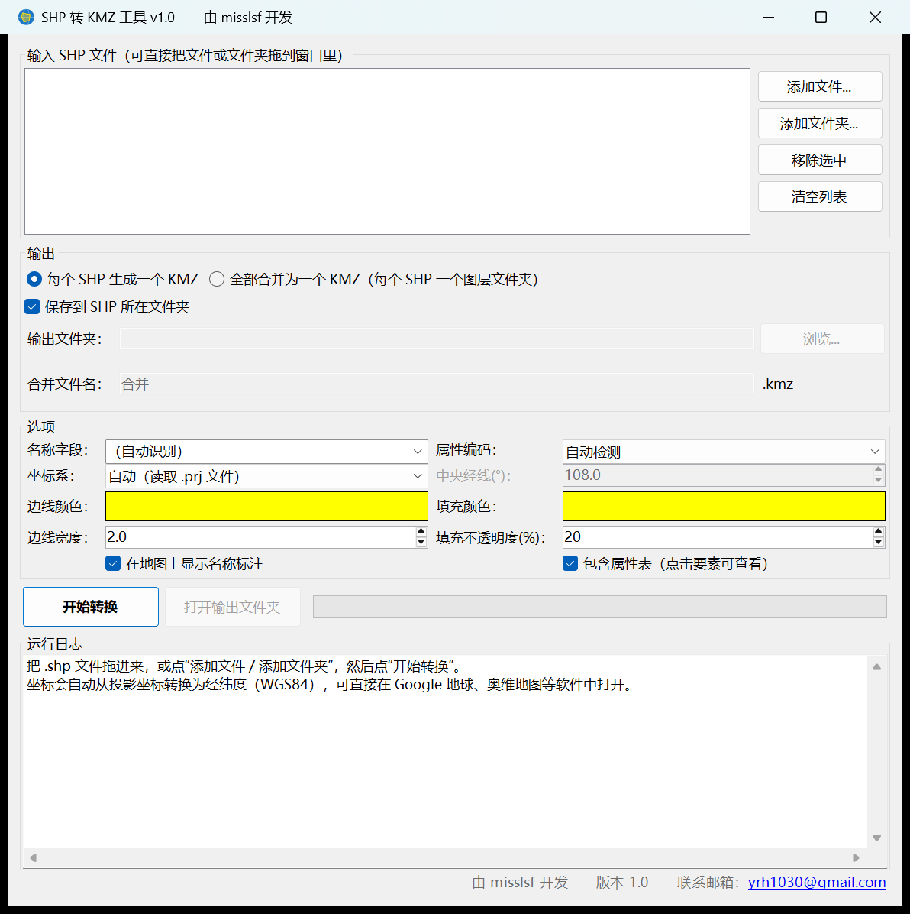

# SHP 转 KMZ 工具 (shp2kmz)

一个免安装的 Windows 小工具，把 ESRI Shapefile（`.shp`）批量转换成 Google 地球 / 奥维地图可以直接打开的 KMZ 文件。

由 misslsf 开发 · 版本 1.0 · 联系邮箱：yrh1030@gmail.com



## 下载

到 [Releases](../../releases/latest) 页面下载 `shp2kmz-v1.0-windows.zip`，解压后双击 `SHP转KMZ.exe` 即可运行。

- 单个 exe，约 60 KB，不需要安装，也不依赖 Python、GDAL、ArcGIS 等软件
- 支持 Windows 10 / 11（系统自带 .NET Framework 4.x）
- 程序没有数字签名，第一次运行时 Windows 可能提示“已保护你的电脑”，点“更多信息 → 仍要运行”即可

## 功能

- **批量转换**：拖入文件或整个文件夹（含子文件夹），每个 SHP 生成一个 KMZ，或合并为一个 KMZ
- **自动坐标转换**：读取 `.prj`，把投影坐标转换为 WGS84 经纬度
  - 高斯-克吕格 / 横轴墨卡托（CGCS2000 3 度带、6 度带等）
  - 墨卡托 / Web 墨卡托
  - 地理坐标（经纬度）
  - 没有 `.prj` 时根据坐标中的带号自动判断，或手动指定中央经线
- **中文属性不乱码**：根据 `.cpg` 文件和 DBF 语言标记自动识别 GBK / UTF-8
- **属性表**：在 Google 地球中点击图斑即可查看全部属性
- **名称标注**：自动选用“小班号 / 名称 / 编号”等字段作为标注，也可手动选择
- **样式**：边线颜色、线宽、填充颜色和透明度可调
- 支持点、多点、线、面（含 Z / M 类型），正确处理带洞的多边形

## 注意事项

- CGCS2000 与 WGS84 的差异在厘米级，可直接使用。
- 西安 80、北京 54 坐标系的数据未做七参数转换，在 Google 地球中可能偏移几十至一百多米，软件会给出提示。
- 暂不支持 Albers、兰伯特等其他投影，可先在 ArcGIS / QGIS 中投影为 CGCS2000 或 WGS84 后再转换。

## 从源代码编译

不需要安装 Visual Studio。双击 `src\build.bat`，会使用 Windows 自带的 C# 编译器（`csc.exe`）生成 `SHP转KMZ.exe`。

```
src/
  Core.cs        Shapefile / DBF 读取、坐标转换、KML 生成
  MainForm.cs    界面
  Program.cs     程序入口
  AppInfo.cs     版本和作者信息
  build.bat      编译脚本
```

## 反馈

欢迎在 [Issues](../../issues) 中提交问题和建议，或发邮件到 yrh1030@gmail.com。

## 许可证

[MIT](LICENSE) © 2026 misslsf
